

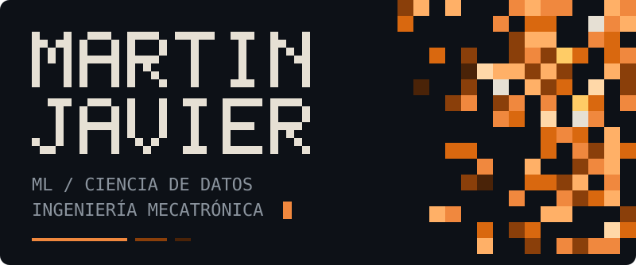

[🇺🇸 English](./README.md) · 🇲🇽 **Español**

 

Vengo de la automatización industrial (PLCs, sensores, líneas de producción) y ahora construyo modelos de machine learning para datos industriales y de señales. Me importa menos el score más alto y más poder explicar **por qué** un resultado es confiable: el split, la métrica, el threshold.

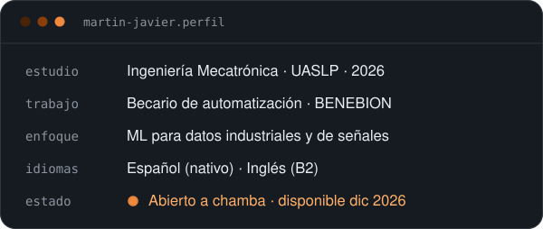

 

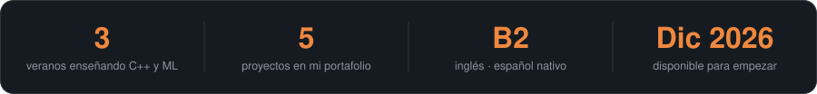

 

<a href="https://github.com/TU_USUARIO/TU_REPO_AI4I">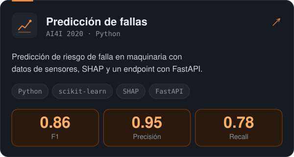</a>
<a href="https://github.com/TU_USUARIO/TU_REPO_RAMAN">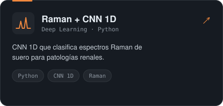</a>

<a href="https://github.com/TU_USUARIO/TU_REPO_FV">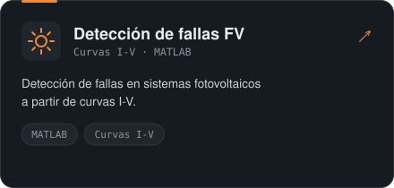</a>
<a href="https://github.com/TU_USUARIO/TU_REPO_RASTRO">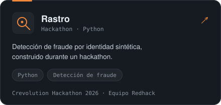</a>

<a href="https://github.com/TU_USUARIO/TU_REPO_PLC">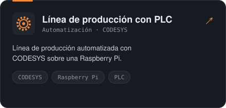</a>
<a href="https://github.com/TU_USUARIO/TU_REPO_NLP">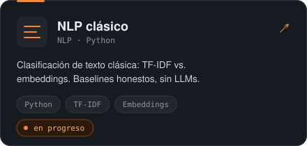</a>

 

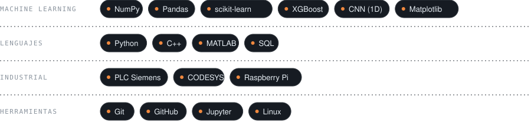

 

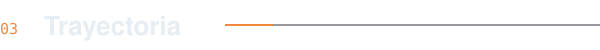

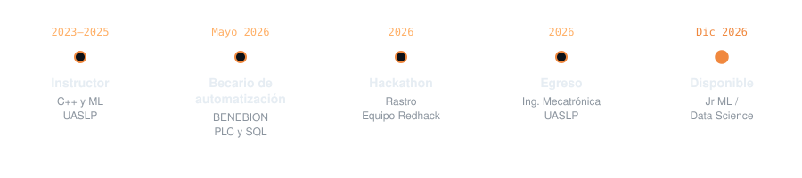

 

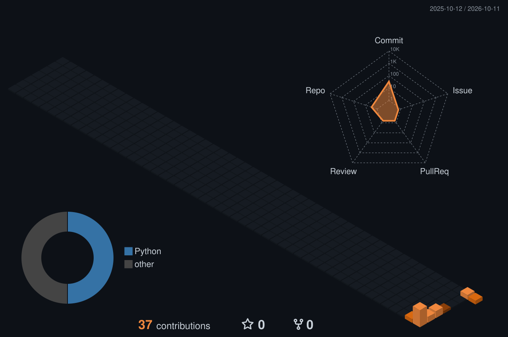

  

 

¿Tienes una máquina que habla y nadie la escucha, o una vacante Jr que encaje? Hablemos.

 

Gracias por pasar.

