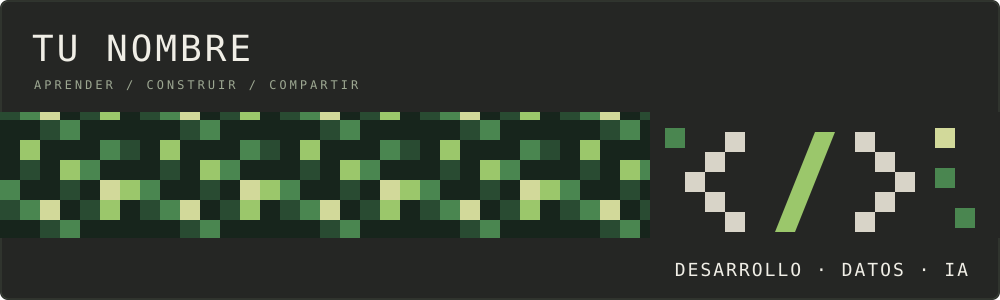
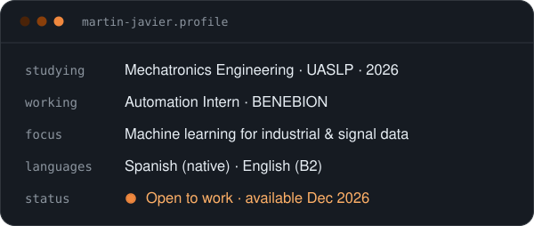
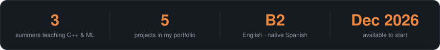
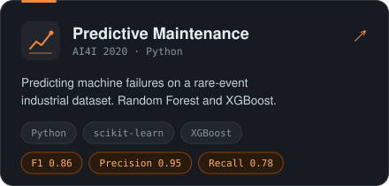
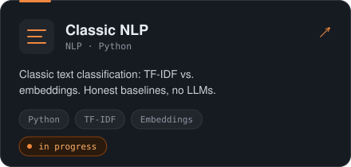
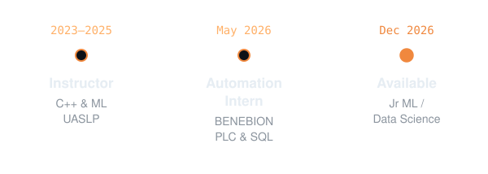

🇺🇸 **English** · [🇲🇽 Español](./README.es.md)

 

I come from industrial automation (PLCs, sensors, production lines) and now build machine learning models for industrial and signal data. I care less about the highest score and more about being able to explain **why** a result can be trusted: the split, the metric, the threshold.

 

 

Toolbox

  <strong>AI & Machine Learning</strong>
    
  
  
  
  

  <strong>Development & Data</strong>
    
  

  <strong>Programming Languages</strong>
    
  

 

  

Thanks for stopping by.

