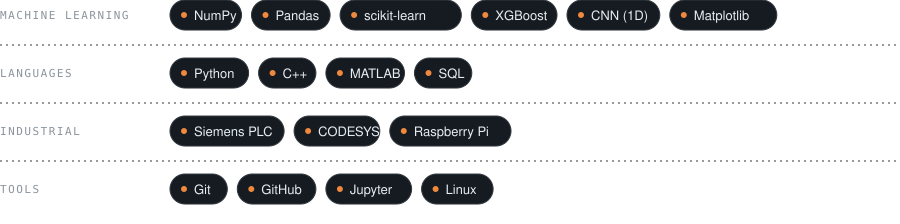

🇺🇸 **English** · [🇲🇽 Español](./README.es.md)

 

I come from industrial automation (PLCs, sensors, production lines) and now build machine learning models for industrial and signal data. I care less about the highest score and more about being able to explain **why** a result can be trusted: the split, the metric, the threshold.

 

 

 

 

 

  

 

Have a machine that's talking and nobody's listening, or a Jr role that fits? Let's talk.

 

Thanks for stopping by.

